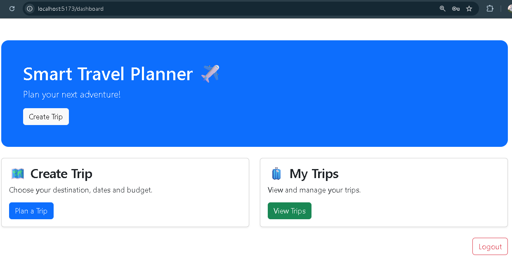
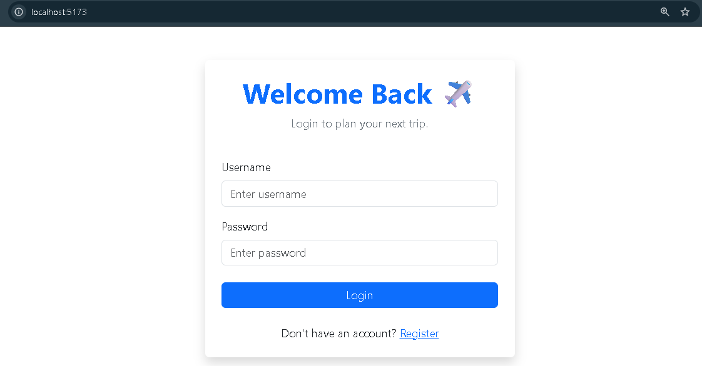
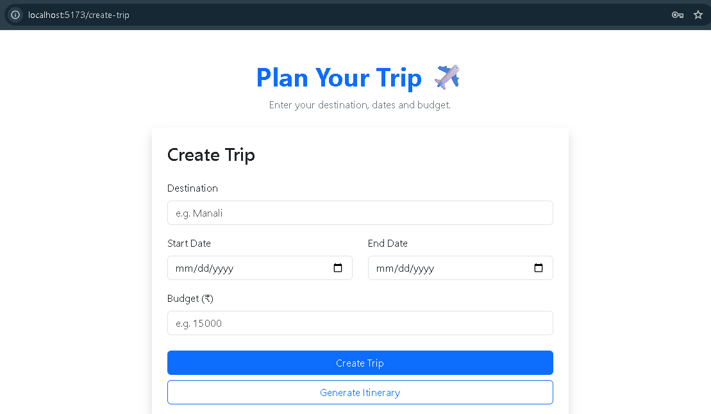
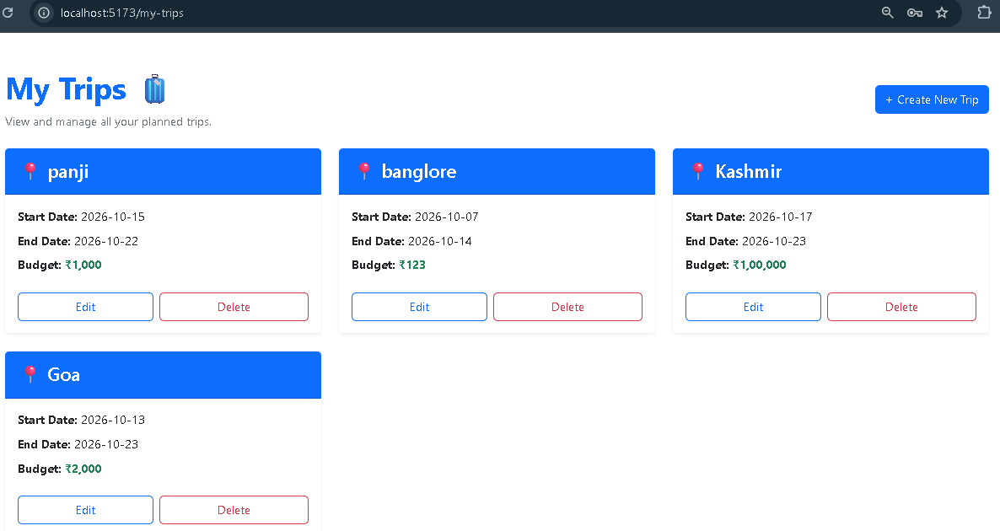
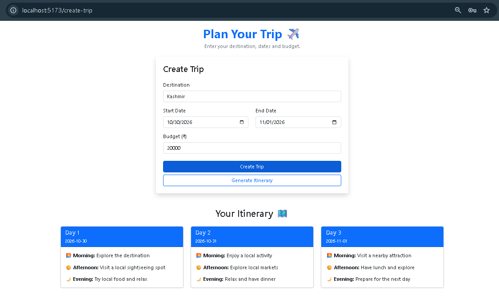

# Smart Travel Planner

Smart Travel Planner is a full-stack web application that helps users organize trips, manage travel budgets, and generate suggested travel itineraries in one place.

## Features

- **User Registration and Login** — Create an account and log in.
- **Trip Management** — Create, view, edit, and delete trips.
- **Budget Planning** — Set a budget for planned trips.
- **Itinerary Generation** — Generate suggested itineraries using the application's implemented logic.
- **Trip Dashboard** — View and manage travel plans through a simple interface.

## Technology Stack

**Frontend**
- React
- JavaScript
- HTML and CSS
- Bootstrap

**Backend**
- Python
- Django
- Django REST Framework
- JWT Authentication

**Database**
- MySQL

## Project Structure

```text
SmartTravelPlanner/
├── Backend/
│   ├── config/
│   ├── trips/
│   ├── manage.py
│   └── requirements.txt
├── Frontend/
│   ├── public/
│   ├── src/
│   ├── package.json
│   └── index.html
├── screenshots/
└── README.md
```

## Installation and Setup

### Backend Setup

1. Open a terminal in the `Backend` folder.
2. Create and activate a Python virtual environment.
3. Install the required packages:

   ```bash
   pip install -r requirements.txt
   ```

4. Configure Django settings and your MySQL database using your local credentials.
5. Run the database migrations:

   ```bash
   python manage.py migrate
   ```

6. Start the Django development server:

   ```bash
   python manage.py runserver
   ```

### Frontend Setup

1. Open another terminal in the `Frontend` folder.
2. Install the dependencies:

   ```bash
   npm install
   ```

3. Start the React development server:

   ```bash
   npm run dev
   ```

4. Open the local URL displayed in the terminal.

## Screenshots

### Home Page


### Login Page


### Create Trip


### My Trips


### Generate Itinerary


## Future Improvements

- Enhance itinerary recommendations.
- Improve the user experience and error handling.
- Add more travel-planning capabilities.

## Author

**Karuna M. Naik**
